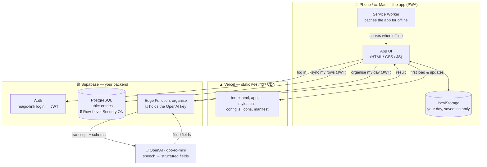
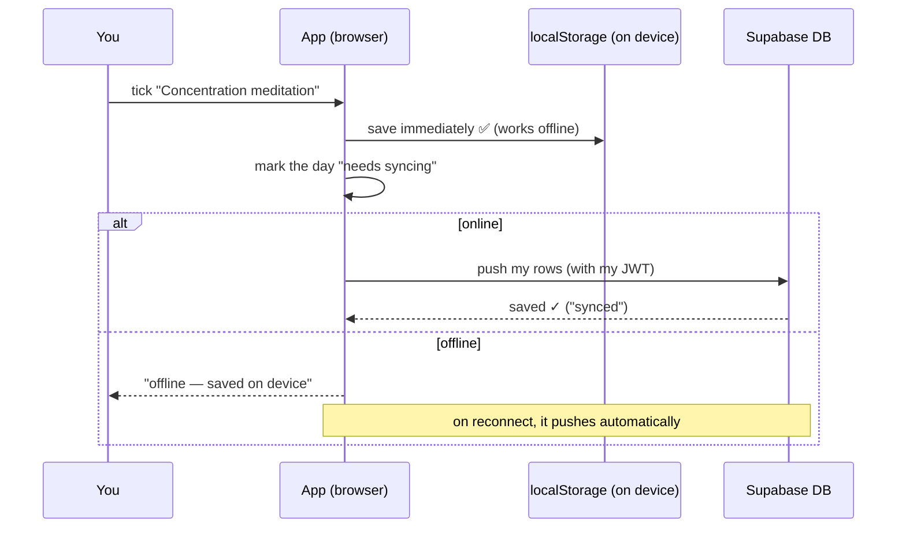
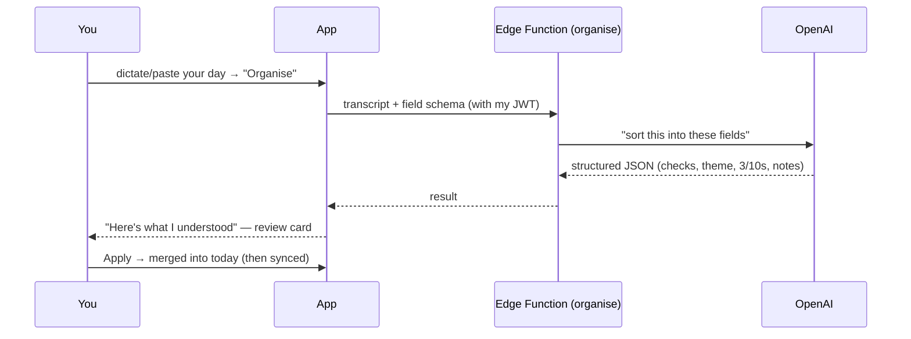

# Daily Practice — How It Works, and Why (Architecture + Security)

A plain-English + technical tour of everything we built, why each piece exists, and every
security decision we made. Written to be read top-to-bottom over a coffee.

---

## 1. The whole thing in one breath

You have a **journal app**. It needs to: run on your phone and laptop, work offline, remember
your entries across devices, and let you *speak* your day and have it sorted into the checklist.

To do that, four separate services each do one job:

| Piece | Plain English | What it actually is |
|---|---|---|
| **The app (PWA)** | The thing you tap and type into | HTML/CSS/JavaScript running in your browser |
| **Vercel** | The place that hands your phone the app's files | A static web host / CDN |
| **Supabase** | Your login + your database (the memory) | PostgreSQL + Auth + a small serverless function |
| **OpenAI** | The brain that turns your spoken day into filled boxes | `gpt-4o-mini` behind an API |

The golden rule to hold onto: **the *app* is public, but your *data* is private.** Those are two
completely different things, protected by two completely different mechanisms. Most of the
confusion about "is this safe?" dissolves once that distinction clicks. (More in §6.)

---

## 2. The map



Plain-text version of the same picture:

```
  YOUR DEVICE (the app)                 THE CLOUD
  ┌─────────────────────────┐
  │ App UI  ⇄  localStorage  │   ── loads files ──▶  ▲ VERCEL (serves the app)
  │   ⇡ (offline cache = SW) │
  └───────────┬─────────────┘
              │  log in ─────────────▶  🟢 SUPABASE AUTH  (emails you a magic link → JWT)
              │  sync my rows ───────▶  🟢 SUPABASE DB    (Postgres, RLS locks rows to you)
              │  organise my day ────▶  🟢 SUPABASE EDGE FUNCTION ──▶ 🤖 OPENAI
              └────────────────◀───────────────── filled-in journal fields ◀─┘
```

---

## 3. What each piece does (a bit more technical)

### The app is a **PWA** (Progressive Web App)
It's a normal website with two superpowers:
- A **Service Worker** — a tiny script the browser keeps even when you're offline. It caches the
  app's files, so the app *cold-loads with no internet*. This is what makes it feel like a native app.
- A **manifest + icons** — so "Add to Home Screen" gives you a real full-screen app icon.

We chose a PWA over a native iPhone app because one codebase runs on iPhone **and** Mac, needs no
App Store, and works offline — all the things you wanted.

### Vercel = the delivery van
Vercel just stores your app's files and hands them to any browser that asks, fast, over HTTPS.
It runs **no logic of yours** — it's a "static host." Think of it as the website's address and
delivery, nothing more. (This is why making it "public" is harmless — see §6.)

### Supabase = login + memory
Two jobs:
1. **Auth** — handles "who are you?" via a magic link (no passwords). On success it gives your
   browser a **JWT** (a signed token that proves "I am Kesh" for a while).
2. **Database** — a real PostgreSQL database that stores your entries. Plus one small
   **Edge Function** (serverless code) called `organise` that talks to OpenAI.

### OpenAI = the sorter
Only touched during "Speak your day." Your text goes to `gpt-4o-mini`, which returns your words
neatly slotted into the journal's fields. Costs ~$0.0003 per day.

---

## 4. The two flows that matter

### (a) Saving your day — "offline-first sync"
Every tick/note is saved to the device **instantly**, then pushed to the cloud when there's signal.
You never wait on the network, and nothing is lost offline.



### (b) Speak your day — "organise"

Note the **review step**: the AI proposes, *you* approve. It never silently overwrites your words.
If you're offline when you hit Organise, the text is queued and organised automatically on reconnect.

---

## 5. Relational vs non-relational — what's actually going on

**Supabase is PostgreSQL, which is a *relational* database.** Relational = data lives in **tables**
(rows and columns), like a spreadsheet with strict rules, and tables can *relate* to each other by
IDs. The opposite, *non-relational* (NoSQL, e.g. MongoDB), stores free-form documents with looser
structure.

We use **one table**, `entries`:

| Column | Type | Meaning |
|---|---|---|
| `id` | uuid | unique row id |
| `user_id` | uuid | **which user owns this row** (links to the Auth users table) |
| `entry_date` | date | the day |
| `data` | **jsonb** | your checks, notes, and logs for that day (flexible JSON) |
| `updated_at` | timestamptz | last change (used to resolve sync conflicts) |

Notice `data` is **JSONB** — a JSON blob *inside* a relational column. So we get the best of both:
the strict, secure, queryable relational shell (one row per user per day, enforced), with a flexible
JSON body so we can change the checklist without database migrations. That's a deliberate hybrid.

**What databases do for us here, beyond "store stuff":**
- **Constraints** — e.g. "one row per user per day" is enforced by the DB, not hoped for in code.
- **Relationships** — every entry is tied to a real user; delete the user, their entries cascade away.
- **Row-Level Security** — per-row access rules enforced *inside* the database (the big one — §6).
- **Transactions & consistency** — writes are atomic; you don't get half-saved days.

---

## 6. Security — the part you asked most about

### 6.1 Why Vercel "Deployment Protection" was ON, and why we turned it OFF

**What it is:** a Vercel setting that puts a *login-wall in front of the website itself* — only
people logged into your Vercel team can even load the page.

**Why Vercel defaults it ON:** most Vercel projects are *company* work-in-progress. You don't want
random people (or Google's crawler, or a competitor) stumbling onto a half-finished feature or a
staging site. So "hide it behind Vercel login by default" is a sensible, safe default *for that world*.

**Why we turned it OFF for you:** this is a **public consumer app** — the entire point is that you
open a URL on your iPhone with no Vercel account and it just works. The login-wall would literally
block your phone from loading the app.

**Why turning it off is safe (the key insight):** it only makes the **app's files** public — the
HTML/JS/CSS. Those are *meant* to be public, exactly like every website you visit. It does **not**
expose your journal. Your journal lives in Supabase, behind a *separate* lock (your magic-link login
+ Row-Level Security). So:

> Making the **website** public ≠ making your **data** public. We opened the front door of the shop;
> your journal is in a safe in the back that only your fingerprint opens.

We keep the app itself trivially "safe" because there are **no secrets in it**. The only key shipped
in the app is the Supabase **anon key**, which is designed to be public (next point).

### 6.2 The Supabase anon key — why it's fine that it's in the code

The app ships a `SUPABASE_ANON_KEY` (you can literally read it in `config.js`). That's by design.
The anon key just says *"I'm an anonymous visitor of this project."* On its own it grants **nothing** —
it can't read your data, because…

### 6.3 Row-Level Security (RLS) — the real lock, and it's ON

RLS is a rule enforced **inside PostgreSQL** on every single query. We turned it **ON** for the
`entries` table and wrote **4 policies**:

| Action | Policy rule |
|---|---|
| SELECT (read) | `auth.uid() = user_id` |
| INSERT (create) | `auth.uid() = user_id` |
| UPDATE (edit) | `auth.uid() = user_id` |
| DELETE | `auth.uid() = user_id` |

`auth.uid()` is *your* id, proven by your logged-in JWT. Translation: **you can only ever see or
change rows that belong to you, and only when logged in.** Even though the database is reachable over
the internet with the public anon key, an anonymous request sees **zero rows**. Someone else logged
into *their* account sees *their* rows, never yours. The database itself refuses — it's not a check
we do in app code that could be bypassed.

### 6.4 Login: magic link → JWT

You type your email → Supabase emails a one-time link → clicking it proves you own that inbox →
Supabase hands your browser a **JWT** (a signed "this is Kesh until it expires" token). Every request
to the DB or the Edge Function carries that JWT, and that's what `auth.uid()` reads. No passwords to
leak. The weak point becomes *your email inbox* — standard, and fine.

### 6.5 The Edge Function is locked too

The `organise` function requires a valid JWT (`verify_jwt` is on by default). So only *you, logged
in* can spend your OpenAI credits — random internet visitors can't hit it.

### 6.6 Where the actual secrets live (and where they never go)

| Secret | Where it lives | Ever in the app? |
|---|---|---|
| **OpenAI API key** | Inside the Supabase Edge Function (a server-side "secret") | **No** — never sent to the browser |
| **Supabase DB password** | Your `.env` on your Mac only (gitignored) | No |
| **Supabase access token** | Your `.env` on your Mac only (gitignored) | No |
| **Supabase anon key** | In the app — *and that's fine* (see 6.2) | Yes, by design |

Your `.env` (with the real secrets) is in `.gitignore`, so it's never committed or deployed. The
OpenAI key sits only on Supabase's servers, so even reading all the app's code reveals nothing.

### 6.7 One honest privacy note

When you use **Speak your day**, your typed/dictated text is sent to OpenAI to be sorted (and Wispr,
separately, sends your audio to *its* servers to transcribe). For a private reflective journal, worth
knowing your words touch those providers in that moment. Your stored entries otherwise live only in
your Supabase database.

### 6.8 "So what could a bad actor actually do?"

- **Load the app** from the public URL → sure, they see the empty UI. Harmless (it's just a website).
- **Read the anon key** from the JS → yes, and it gets them nothing without *your* login.
- **Query your database** → RLS returns nothing unless they're you (they'd need your live JWT / inbox).
- **Call the AI function** → blocked without a valid login.
- Realistic weak points, same as any app: your **email inbox**, your **Supabase/Vercel/OpenAI account
  logins**, and your **`.env` file** on your Mac. Keep those and you're solid.

---

## 7. Security settings summary (what's on/off and why)

| Setting | State | Why |
|---|---|---|
| Vercel Deployment Protection (login-wall on site) | **OFF** | It's a public app; the wall would block your phone. No secrets in the app, so it's safe. |
| Supabase Row-Level Security on `entries` | **ON** | The real lock — each user sees only their own rows. |
| RLS policies (select/insert/update/delete) | **4, all `auth.uid() = user_id`** | Full CRUD, always scoped to you. |
| Supabase email auth (magic link) | **ON** | Passwordless login. |
| Edge Function JWT verification | **ON** | Only logged-in you can spend OpenAI credit. |
| OpenAI key exposure | **Server-only secret** | Never shipped to the browser. |
| `.env` (DB password, access token, OpenAI key) | **Gitignored, local only** | Never committed or deployed. |
| Anon key in app | **Public by design** | Grants nothing without RLS-passing auth. |

---

## 8. Costs (so there are no surprises)

- **Vercel** — free (Hobby).
- **Supabase** — free tier, plenty for a personal journal.
- **OpenAI** — ~**$0.0003 per "organise"**; a $5 top-up lasts years.

---

## 9. What's still optional / not built

- **In-app offline *audio* recording** (record voice with no signal → transcribe on reconnect). Not
  built. Note: Wispr needs internet anyway, so true offline voice *requires* this piece — it's the
  only remaining real feature if you want it.
- **Reminders** — coded, not switched on/tested yet.

Everything else — offline checklist, sync, streaks/calendar, speak-your-day with review — is live.
